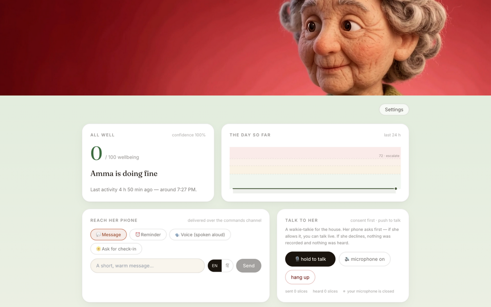
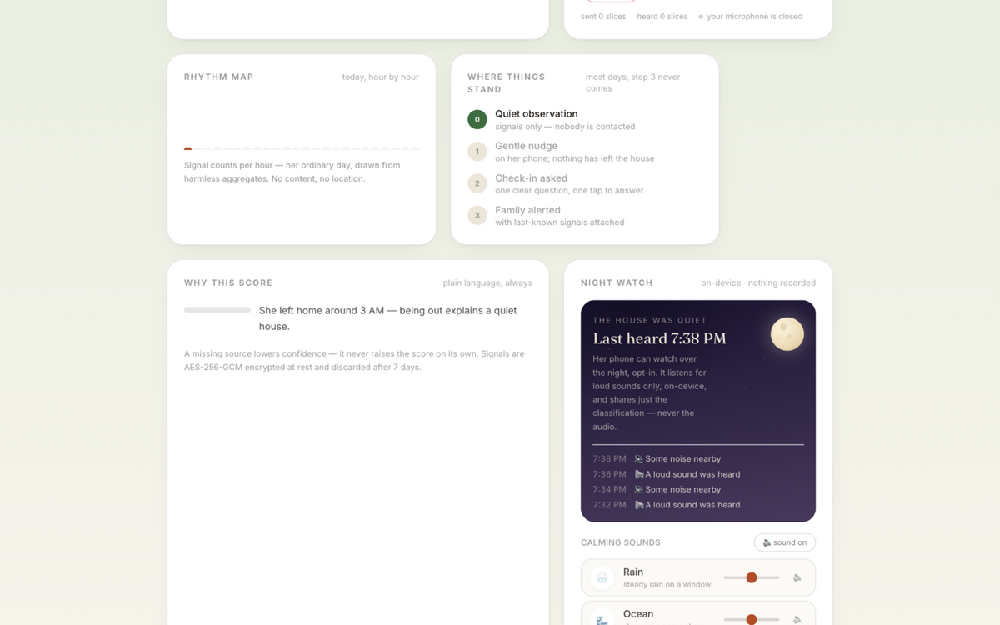
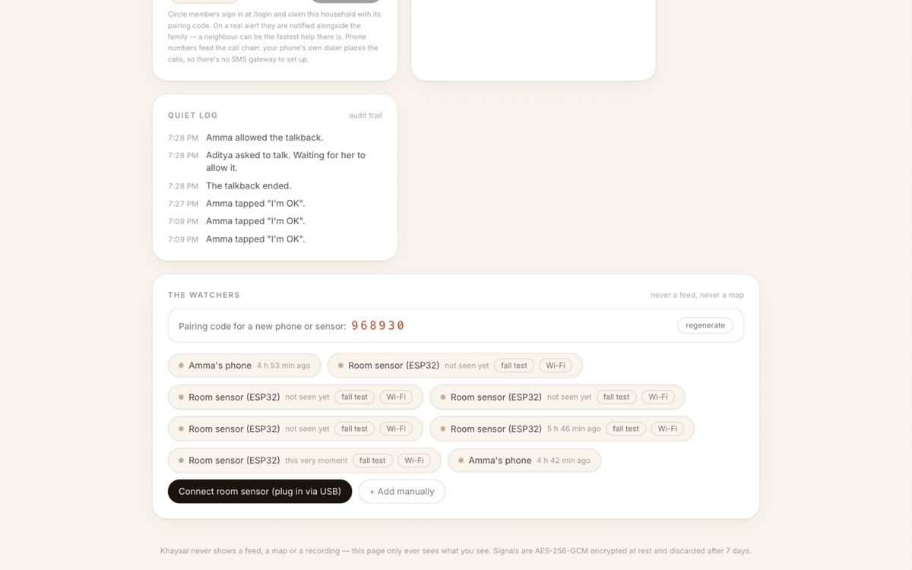
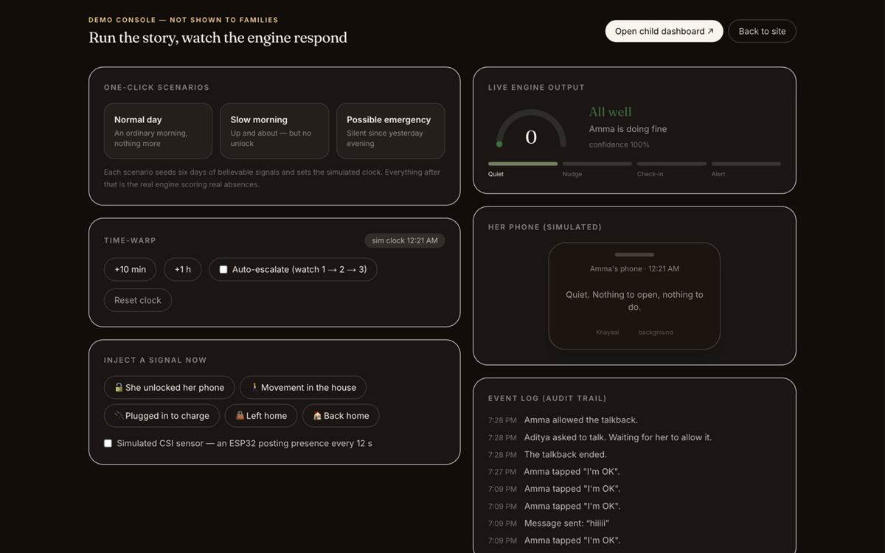

<div align="center">

# Khayaal

**A silent guardian for elderly parents living alone.**
Nothing to press. Nothing to wear. Nothing to remember.

[](https://github.com/theguysudo/Khyaal/actions/workflows/ci.yml)


*Khayaal reads the ordinary signals an ordinary day already produces — and says
nothing until absence starts to tell a story.*

**Team Sudo** — Aditya Dubey, Kunal Raghuvanshi, Jatin Singh,
IILM University, Greater Noida.

</div>

---

## What it does, and why

An elderly parent lives alone. Her family wants to know she is all well —
without her having to do anything, and without anyone watching her through a
window.

Most "monitoring" products solve this by adding a camera, a wearable or a
daily phone call. Khayaal refuses all three. It reads the signals a phone and
a room already produce — whether she unlocked it this morning, whether she
moved around the house, whether it went on charge overnight, whether the room
sensor felt anyone, whether she has been silent for hours — and learns what
*ordinary* looks like **for this one person**. Then it does the only thing
that matters: when several absences line up, it tells the family, in plain
language, what it noticed and what it did.

> **Absence is the signal.**
>
> Presence proves very little — a phone that pings every hour says nothing.
> But a phone that has not moved since dawn, has not been unlocked, has not
> charged, and whose room has felt nobody for three hours is telling a story.
> Khayaal is built to notice that story, and to stay silent otherwise.

**What it is not:** it is not a surveillance feed, not a tracker, not a
panic-button product, and not something that asks her to remember anything.
The family sees a calm status — never raw data, never a feed, never a map.

---

## How it senses

**Her phone** (`apps/android`, the app she already owns) watches for harmless
moments — screen unlocks, walking, the evening charger, a home-Wi-Fi match,
today's steps — and posts them to the household. Movement numbers and the
home/away zone are computed **on-device**; latitude and longitude never leave
the phone. An opt-in **night watch** classifies loudness on-device and shares
only sleep milestones and loudness buckets — audio bytes are never written to
disk and never uploaded.

**The room sensor** (`firmware/`, an optional ESP32) senses presence through
Wi-Fi **CSI** (Channel State Information) amplitude variance — no camera, no
microphone, nothing worn. Only derived scalars leave the device; raw
subcarrier I/Q never does. A near-field **reflective IR beam** (an LM393
photoelectric module, centimetres of range) rides alongside as an auxiliary
`ir_reflective` signal — it can say "something is right here", never who or
what the room looks like, and it never overrides the CSI verdict.

**The engine** (`packages/engine`, pure TypeScript, 25 unit tests) fuses
everything into one wellbeing score, weighted by absence:

| Missing signal | Points |
| --- | --- |
| No morning unlock past her usual wake time | 30 |
| No movement for 6 h | 28 |
| Total silence (no signal at all) | 20 |
| Room sensor has felt nobody | 18 |
| GPS stillness (a hint, weaker than a declared zone) | 18 |
| No overnight charge | 16 |

One weak signal proves nothing — the score is the sum, clamped 0–100, and the
family's view shows the reasoning in plain language. The ladder climbs one
step at a time across score bands **35 / 55 / 72**, and each step needs its
dwell timer (10 / 10 / 15 min by default). Quiet hours hold the ladder at a
nudge unless the score is ≥ 85; thin data lowers confidence and caps the
reachable tier instead of raising the score. A sensed **fall skips the whole
ladder** — dwell timers, quiet hours, confidence gate — because that is
precisely the moment the family must be called, even at 3 am.

**Not every device is trusted equally.** The room sensor's key is typed into a
board that sits physically in her bedroom, so it is the least-protected
credential in the deployment — and the API treats it that way
(`apps/web/lib/server/authz.ts`):

| Privilege | Her phone | Demo console device | Room sensor |
| --- | :-: | :-: | :-: |
| Read state & CSI stream | ✓ | ✓ | ✓ |
| Post signals | ✓ | ✓ | ✓ |
| Poll its own device queue / report Wi-Fi | ✓ | ✓ | ✓ |
| File her "I'm OK" check-in | ✓ | ✓ | — |
| Silence the alert ladder (snooze) | ✓ | ✓ | — |
| Spend the family's LLM budget | ✓ | ✓ | — |
| Register for push alerts | ✓ | ✓ | — |
| Open or answer talkback | ✓ | ✓ | — |

Every household route is authorised, an unauthorised or unknown id answers
**404** — never 401 or 403 — so the API is not an existence oracle, and a
device that lacks a scope gets the same 404 a stranger gets: the surface never
says "your key is real, but too weak for this."

---

## See it

<div align="center">



**The family dashboard.** One calm number, a plain-language "why", the
commands channel, and a walkie-talkie that opens a microphone only after the
other side taps *Allow*.

</div>

<div align="center">



**The bento, mid-page.** The rhythm map draws her ordinary day from harmless
aggregates; the escalation ladder shows exactly who has been contacted (at
tier 0: nobody); night watch narrates the night and plays calming sounds the
browser makes itself.

</div>

<div align="center">



**THE WATCHERS.** Every paired device, live: the room sensor's dot is green —
it reported presence *this very moment*. The same card runs a fall test and
manages the sensor's Wi-Fi, laptop-style, over the USB relay.

</div>

<div align="center">



**The demo console** (`/demo`) — seeded scenarios, a time-warp clock, a
simulated phone, and the engine's live output. The simulated sensor is a
drop-in replacement for the real board: nothing in the engine or API changes
when one replaces the other.

</div>

## The demo, alive

<div align="center">


*A slow scroll down the family dashboard, ending on THE WATCHERS: the ESP32
room sensor is reporting over its sealed tunnel at that very moment (green
dot). No feed, no map — a status and a heartbeat.*

</div>

Run it yourself: open `/demo`, press **Possible emergency**, and watch the
engine seed six days of believable absences and climb the ladder in real time.
`docs/FIVE_MINUTE_DEMO.md` has the timed run-of-show for the hardware demo —
phone face-down on the desk, board in the corner, dashboard on the screen.

---

## Architecture

```
khayaal/
├── apps/
│   ├── web/        Next.js 15 · React 19 · TypeScript · Tailwind
│   │               the family dashboard, the demo console, the one API
│   └── android/    Kotlin · Jetpack Compose · WorkManager · AndroidKeyStore
│                   her app: passive signals, gentle nudges, the alarm
├── packages/
│   ├── engine/     pure TypeScript risk engine — the whole ladder, unit-tested
│   └── shared/     the one contract every client speaks
├── firmware/
│   ├── esp32-csi-sensor/   PlatformIO · Espressif esp-csi · mbedtls
│   └── tunnel/             the Python USB-serial bridge (pyserial · cryptography)
└── docs/           security audit, pentest report, setup guide, demo script
```

**One contract.** The phone, the board, the USB bridge and the dashboard all
speak the same small REST API under `/api/v1` — `pair`, `ingest`,
`household/{id}/state` (the tick that advances the state machine), `checkin`,
`ack`, and the rest. That is why the demo's simulated sensor and the real
board are interchangeable, and why `advanceState()` is a pure function: same
signals in, same state out, idempotent under 1.5 s polling from any number of
clients.

**The tunnel is sealed.** Sensor traffic on the LAN is protected by
envelope-level crypto, not by trusting the hotspot: the key is derived by
`HKDF-SHA256(sourceApiKey, salt="khayaal-tunnel-v1")` and **never travels**;
each event is sealed as an `enc:"v1"` AES-256-GCM envelope bound to
`householdId|sourceId` as AAD, with a 1-hour replay cache (replays → 409, a
flipped byte → 400). The same scheme runs in three implementations — the
Python bridge (`cryptography`), the server (`node:crypto`), and the board
itself (mbedtls). One command re-proves it:
`bash firmware/test-pipeline.sh enc`.

**The USB relay.** In `serial` mode the board emits one JSON line per event
over USB; `firmware/tunnel/khayaal_serial_bridge.py` fills in the identity,
stamps time when the board had no NTP, seals, and POSTs — reconnecting with
backoff if the cable hiccups. In `lan` mode the board posts directly. The
relay also polls the device action queue, which is how the dashboard's Wi-Fi
scan / join / forget reaches the board without anyone typing a serial command.

**Stored sealed, discarded on schedule.** Every signal at rest is an
AES-256-GCM envelope in the store; the child-facing state bundle contains no
raw signals and no API keys — the UI cannot leak what it never receives.
Signal history is discarded after **7 days**.

---

## Run it

**Web + engine**

```bash
npm install          # workspaces: web + shared + engine
npm test             # engine unit tests
npm run dev          # http://localhost:3100
```

No environment variables are needed for the demo — the server uses an
in-process memory store and all state resets when it restarts. Optional
features (Google sign-in, LLM providers, Firebase, push, SMTP) wake up when
`apps/web/.env.local` exists; the file is gitignored — never commit a key.

**Her phone (Android)** — JDK 17, Android SDK 35, Gradle 8.10.2:

```bash
cd apps/android && gradle assembleDebug
# → app/build/outputs/apk/debug/app-debug.apk
```

CI builds the APK on every push and publishes it as an artifact. Full notes,
the signal-mapping table and the build quirks live in `apps/android/README.md`.

**The room sensor (ESP32)** — no hardware needed for the first three:

```bash
bash firmware/test-pipeline.sh sim       # fake sensor → bridge → backend
bash firmware/test-pipeline.sh lan       # direct ingest, like the board's LAN mode
bash firmware/test-pipeline.sh enc       # sealed / replay-rejected / tamper-rejected
bash firmware/test-pipeline.sh hardware  # the real board over USB
bash firmware/test-pipeline.sh flash     # erase + write the firmware
```

The pipeline asserts in PASS/FAIL form and exits non-zero on failure.
`firmware/README.md` covers bring-up, calibration and placement.

---

## Security

Khayaal's threat model is unusual for a project this size: the data is about a
dependent person, so **false alerts and silenced alerts are both safety
failures**, and the household API is reachable from a shared hotspot during
demos.

- **Audited route by route.** `docs/SECURITY_AUDIT.md` walks every household
  route and transport and lists what was found and fixed — household
  authorization (F1), source-creation key minting (F2), keyless ingest (F3),
  unbounded LLM proxy input (F4), the plaintext tunnel (F5).
- **Pen-tested, 46/46.** A later engagement
  (`docs/STRIX_PENTEST.md`, ~2,500 requests across nine phases) found and
  closed pairing-code brute force, history-wiping future timestamps, CSPRNG
  credential minting, pairing-code replay and over-broad device privileges;
  the repo's own suite (`apps/web/scripts/pentest.sh`) passes **46/46** on the
  final build.
- **Private by construction.** No camera anywhere in the sensing path; no
  location permission on the phone; app usage is package names only; talkback
  audio exists in memory for the duration of one consent-gated call and is
  never written to disk; her pairing key is sealed with an AndroidKeyStore
  AES-256-GCM key; the LLM key lives on the server, never in the app.
- **Minimal surface.** Signed HttpOnly SameSite session cookies, per-source
  keys shown exactly once, pairing codes rotated after use, sliding-window
  rate limits, strict transport headers, and 404 existence-hiding on every
  household route.

Honest limits — LAN HTTP between device and server (protected by the envelope,
not TLS), per-process rate limits, and the demo pair endpoint — are written
down in the audit rather than waved away.

---

## License

[Apache License 2.0](LICENSE).
